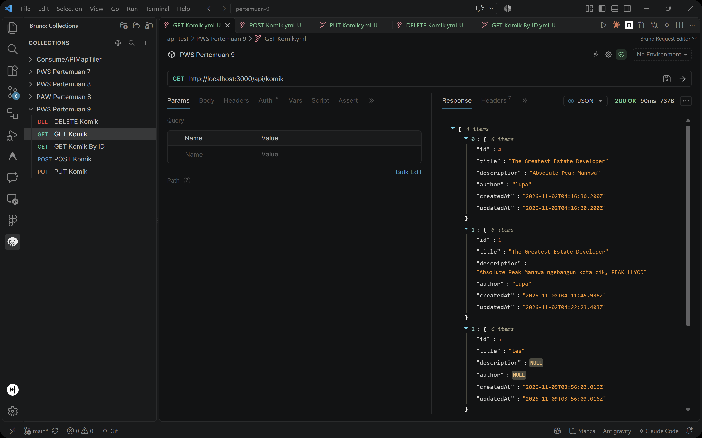
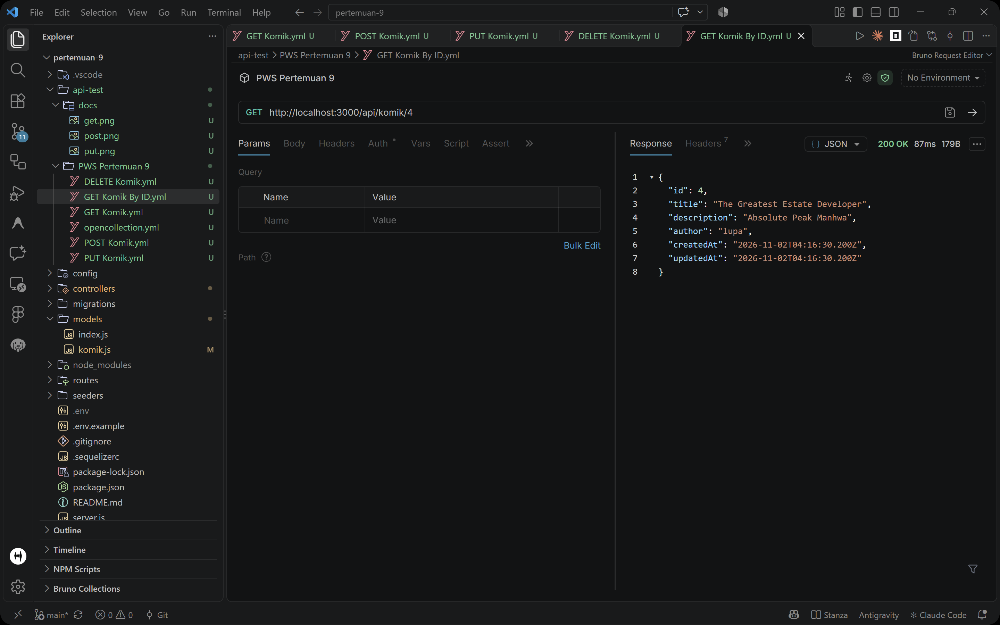
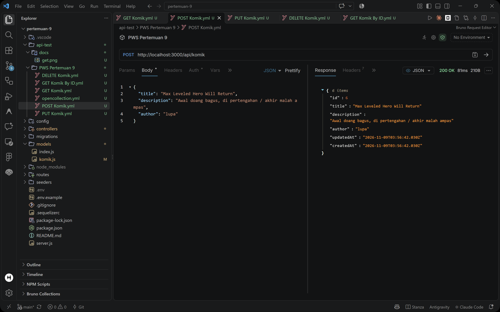
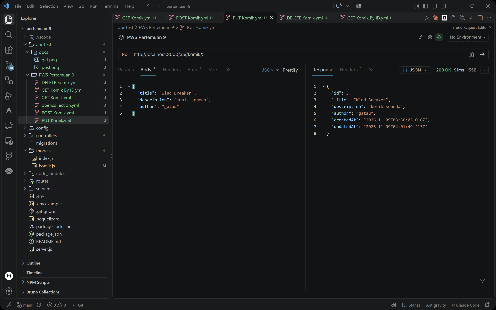
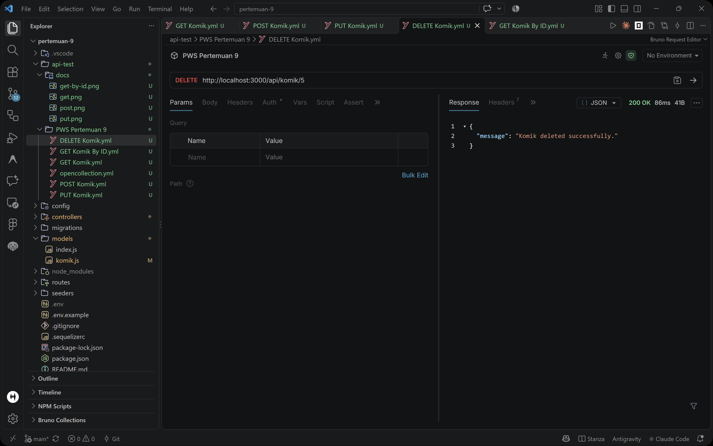

# Penugasan Pertemuan 9 - Praktikum Pemrograman Web Service (PWS)

REST API sederhana untuk manajemen data komik (CRUD) menggunakan **Node.js**, **Express.js**, dan **Sequelize ORM** dengan database **PostgreSQL**.

---

## 📌 Daftar Endpoint API

| Method           | Endpoint           | Deskripsi                             |
| :--------------- | :----------------- | :------------------------------------ |
| **GET**    | `/api/komik`     | Mengambil seluruh data komik          |
| **GET**    | `/api/komik/:id` | Mengambil detail komik berdasarkan ID |
| **POST**   | `/api/komik`     | Menambahkan data komik baru           |
| **PUT**    | `/api/komik/:id` | Memperbarui data komik berdasarkan ID |
| **DELETE** | `/api/komik/:id` | Menghapus data komik berdasarkan ID   |

---

## 📸 Dokumentasi & Hasil Pengujian API

Berikut adalah hasil pengujian endpoint API menggunakan API client (Bruno):

### 1. GET - Ambil Semua Komik

Mengambil seluruh daftar komik yang tersimpan di database.

- **Method**: `GET`
- **URL**: `http://localhost:3000/api/komik`



---

### 2. GET by ID - Ambil Komik Berdasarkan ID

Mengambil data detail dari satu komik spesifik menggunakan parameter `id`.

- **Method**: `GET`
- **URL**: `http://localhost:3000/api/komik/:id`



---

### 3. POST - Tambah Komik Baru

Menambahkan data komik baru ke database.

- **Method**: `POST`
- **URL**: `http://localhost:3000/api/komik`
- **Body (JSON)**:
  ```json
  {
    "title": "Max Leveled Hero Will Return",
    "description": "Awal doang bagus, di pertengahan / akhir malah ampas",
    "author": "lupa"
  }
  ```



---

### 4. PUT - Perbarui Data Komik

Memperbarui informasi data komik yang sudah ada berdasarkan parameter `id`.

- **Method**: `PUT`
- **URL**: `http://localhost:3000/api/komik/:id`
- **Body (JSON)**:
  ```json
  {
    "title": "Wind Breaker",
    "description": "komik sepeda",
    "author": "gatau"
  }
  ```



---

### 5. DELETE - Hapus Komik

Menghapus data komik dari database berdasarkan parameter `id`.

- **Method**: `DELETE`
- **URL**: `http://localhost:3000/api/komik/:id`



---

## 🚀 Cara Menjalankan Proyek

1. **Clone repositori atau buka direktori proyek**:

   ```bash
   cd pertemuan-9
   ```
2. **Install dependensi**:

   ```bash
   npm install
   ```
3. **Konfigurasi Environment**:
   Salin `.env.example` menjadi `.env` lalu sesuaikan konfigurasi database Anda:

   ```env
   APP_PORT=3000
   DB_USERNAME=postgres
   DB_PASSWORD=your_password
   DB_NAME=your_database_name
   DB_HOST=127.0.0.1
   DB_DIALECT=postgres
   ```
4. **Jalankan Migrasi Database**:

   ```bash
   npx sequelize-cli db:migrate
   ```
5. **Jalankan Server**:

   ```bash
   npm start
   ```
   Server akan berjalan di `http://localhost:3000`.
